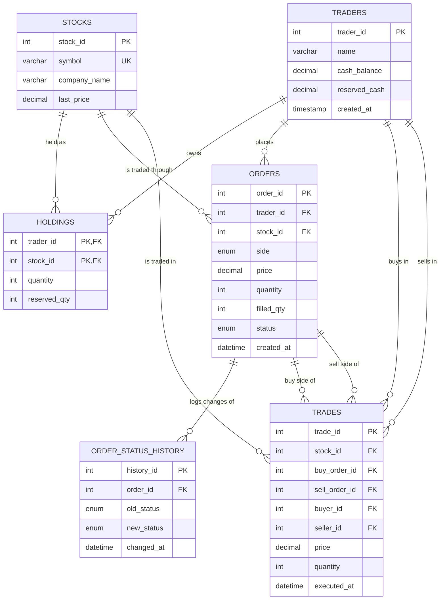

# OrderBook

A command-line stock exchange simulator written in **C++17** with **MySQL 8**, built as a
B.Tech DBMS lab project.

Traders place **limit orders** to buy or sell shares. The system keeps a list of waiting
orders for every stock (the *order book*). When a buyer's price meets or beats a seller's
price, the two orders are matched and a **trade** happens: cash moves from buyer to seller,
shares move from seller to buyer, and the trade is recorded. If only part of an order can be
matched, the matched part trades and the rest keeps waiting.

> Example: a buyer offers up to ₹50 per share for 10 shares and a seller asks at least ₹45
> for 10 shares. They trade at ₹45, the price of the order that was already waiting.

---

## 1. How the work is split

| Part | Responsibility |
|------|----------------|
| **C++ program** | Command-line interface, the in-memory order book, and the matching algorithm (*who trades with whom*). |
| **MySQL** | Source of truth for money and shares. Every change to balances, holdings, orders and trades happens inside **stored procedures** within **transactions**. |

C++ never updates a balance itself. A crash or a matcher bug therefore cannot corrupt the
financial records: the database rejects anything inconsistent (constraints, triggers) and
rolls back the whole operation.

```
 you ──> CLI ──> MatchingEngine ──> Database layer ──> MySQL
                 (in-memory book:    (calls stored      (tables, constraints, triggers,
                  price-time          procedures)        stored procedures, views)
                  priority)
```

---

## 2. Project layout

```
orderbook/
  CMakeLists.txt
  orderbook.conf.example      copy to orderbook.conf and edit
  README.md
  sql/
    01_schema.sql             tables, constraints, indexes
    02_demo_seed.sql          demo data (same data is inside sp_reset_demo)
    03_routines.sql           functions + stored procedures (incl. sp_reset_demo)
    04_triggers.sql           triggers
    05_views.sql              views
    06_test_step2.sql         direct SQL tests of procedures/triggers/views
    07_explain_index.sql      EXPLAIN comparison with / without the composite index
  src/
    main.cpp                  startup: connect, rebuild books, run the CLI
    config.h / config.cpp     reads orderbook.conf and OB_* environment variables
    money.h                   money as whole paise (no floating point)
    db.h / db.cpp             database layer (calls procedures, loads open orders)
    order_book.h              in-memory books (bids, asks, FIFO queues)
    matching_engine.h / .cpp  matching algorithm
    cli.h / cli.cpp           commands, numbered menu
    format.h / format.cpp     tables, colors, ₹ formatting
  tests/
    scenarios.txt             10 test scenarios with expected output
    run_tests.sh              runs the scenarios against the real program
    README.md                 how to run the tests, EXPLAIN results
```

---

## 3. Setup (Ubuntu / WSL)

Requirements: Linux or WSL, a C++17 compiler, CMake, MySQL 8, and MySQL Connector/C++
(the classic JDBC-style API; both the 8.x and the older 1.1.x packages work).

**1. Install the tools**
```
sudo apt update
sudo apt install -y build-essential cmake libmysqlcppconn-dev mysql-server
sudo service mysql start          # in WSL, run this each time you reopen the terminal
```

**2. Load the database** (from the project folder; run `01_schema.sql` only once, because it
drops and recreates the `orderbook` database)
```
sudo mysql < sql/01_schema.sql
sudo mysql < sql/03_routines.sql
sudo mysql < sql/04_triggers.sql
sudo mysql < sql/05_views.sql
sudo mysql orderbook -e "CALL sp_reset_demo();"
```
`sp_reset_demo()` loads the demo data (`02_demo_seed.sql` holds the same data as plain
INSERTs and is not needed if you run the reset).

**3. Create a database user for the program**
```
sudo mysql -e "CREATE USER 'ob'@'localhost' IDENTIFIED BY 'ob_pass';"
sudo mysql -e "GRANT ALL PRIVILEGES ON orderbook.* TO 'ob'@'localhost'; FLUSH PRIVILEGES;"
```
Choose your own password if you prefer.

**4. Configure the connection**
```
cp orderbook.conf.example orderbook.conf
nano orderbook.conf
```
```
host=127.0.0.1
port=3306
user=ob
password=ob_pass
database=orderbook
```
Connection details are never hard-coded. The environment variables `OB_HOST`, `OB_PORT`,
`OB_USER`, `OB_PASSWORD` and `OB_DB` override the file.

**5. Build and run**
```
mkdir build && cd build
cmake ..
make
cd ..
./build/orderbook
```
Run it from the project folder, because it looks for `orderbook.conf` there.

### Troubleshooting

| Problem | Fix |
|---------|-----|
| `MySQL Connector/C++ not found` | `sudo apt install libmysqlcppconn-dev`, then delete `build/` and run `cmake ..` again |
| `Access denied for user 'ob'` | The user or password does not match `orderbook.conf`. Test with `mysql -u ob -p orderbook`; recreate the user (step 3) or fix the file |
| `Cannot connect to MySQL` | Start the server: `sudo service mysql start`. In WSL with MySQL installed on Windows, `127.0.0.1` will not reach it; use the copy installed inside WSL |
| Access denied only from the program (the `mysql` client works) | The older connector may not support the user's default login method. Run `ALTER USER 'ob'@'localhost' IDENTIFIED WITH mysql_native_password BY 'ob_pass';` (on MySQL 8.4 first enable it with `mysql_native_password=ON` in the `[mysqld]` section of the MySQL config) |
| Empty or wrong data | `CALL sp_reset_demo();` or type `reset` inside the program |

---

## 4. Using the program

Start it with `./build/orderbook`. Type `help` for the command list or `menu` for a numbered
menu that asks for the details and runs the same commands. Log in with a trader id first
(commands about "my" data use the logged-in trader). The demo has traders 1 to 5 (Aarav,
Diya, Kabir, Meera, Rohan).

### Commands

| Group | Command | What it does |
|-------|---------|--------------|
| Account | `register <name> <starting_cash>` | Create a trader |
| | `login <trader_id>` / `logout` | Log in or out |
| | `deposit <amount>` | Add cash to the logged-in trader |
| Trading | `buy <symbol> <price> <qty>` | Place a buy order (matches immediately if possible) |
| | `sell <symbol> <price> <qty>` | Place a sell order |
| | `cancel <order_id>` | Cancel one of your open orders |
| Market data | `stocks` | All companies with last price |
| | `traders` | All traders with id, name, cash |
| | `recent [n]` | Latest orders on the exchange, newest first (default 10) |
| | `book <symbol> [levels]` | Market depth: buyers on the left, sellers on the right, same-price orders combined (default 5 levels) |
| | `summary` | Per stock: trade count, volume, high, low, last price |
| My data | `orders [open\|all] [n]` | My orders (default: open, 10 rows) |
| | `holdings` | My cash and shares, including reserved amounts |
| | `trades [symbol] [n]` | My recent trades |
| | `statement` | My account statement with portfolio value |
| Utility | `reset` | Wipe everything and reload the demo data (asks you to type `yes`) |
| | `menu`, `help`, `exit` | |

Display: aligned tables, **green** for buy, **red** for sell, **yellow** for warnings and
errors (colors switch off automatically if the terminal does not support them), prices as
`₹1,23,456.50`. Bad input always gets a friendly message; the program never crashes on it.

### Example session

```
orderbook> login 3
Logged in as Kabir (id 3).
orderbook (Kabir)> buy TCS 3950 10
Order #16 placed: BUY 10 TCS @ ₹3,950.00
  Traded 10 shares @ ₹3,920.00  (with order #9)
  Order completely filled.
orderbook (Kabir)> holdings
```
Kabir offered up to ₹3,950 but paid ₹3,920, the price of the waiting sell order (#9). The
₹300 difference (₹30 per share) is never charged: it stays in his available cash.

---

## 5. Matching rules

* **Price-time priority.** For each stock there is a *bid* book (buy orders, highest price
  first) and an *ask* book (sell orders, lowest price first). Each price level is a
  first-in-first-out queue, so at the same price the earlier order trades first.
* A new **buy** matches while the best ask is **at or below** its price. A new **sell**
  matches while the best bid is **at or above** its price.
* **Execution price** = the price of the order that was already resting in the book.
* **Fill quantity** = the smaller of the two remaining quantities.
* **No self-trading.** Orders from the same trader are skipped, never matched.
* Anything unfilled stays in the book as `OPEN` (nothing filled) or `PARTIAL`.
* Only OPEN and PARTIAL orders live in memory; filled and cancelled orders exist only in MySQL.
* **Startup recovery.** On start the program loads all OPEN and PARTIAL orders from MySQL,
  oldest first, and rebuilds the books. Closing and reopening loses nothing.
* If a trade fails in MySQL, it is rolled back, the in-memory book is left unchanged, the
  error is shown and matching for that order stops.

### Reservations

A **buy** order reserves cash equal to `price × quantity`; a **sell** order reserves shares
equal to its quantity. *Available* cash = `cash_balance − reserved_cash`; *available*
shares = `quantity − reserved_qty`. Reservations are released when an order is filled or
cancelled. This is what stops a trader from promising the same money or shares twice.

---

## 6. Database design

### ER diagram



(If your viewer does not draw Mermaid, paste the block into <https://mermaid.live>.)

In words: a trader owns many holdings (one row per trader per stock) and places many orders;
a stock appears in many holdings, orders and trades; an order can be part of many trades
(partial fills) on either its buy side or its sell side; an order has a history of status
changes.

### Tables and constraints

| Table | Key | Main constraints |
|-------|-----|------------------|
| `traders` | `trader_id` | `cash_balance ≥ 0`, `reserved_cash ≥ 0`, `reserved_cash ≤ cash_balance` |
| `stocks` | `stock_id`; `symbol` unique | `last_price > 0` |
| `holdings` | (`trader_id`, `stock_id`) | foreign keys to traders and stocks; `quantity ≥ 0`, `reserved_qty ≥ 0`, `reserved_qty ≤ quantity` |
| `orders` | `order_id` | foreign keys; `side` ∈ {BUY, SELL}; `price > 0`; `quantity > 0`; `0 ≤ filled_qty ≤ quantity`; `status` ∈ {OPEN, PARTIAL, FILLED, CANCELLED}; `created_at` has microseconds (time priority) |
| `trades` | `trade_id` | five foreign keys; `price > 0`; `quantity > 0` |
| `order_status_history` | `history_id` | foreign key to orders |

All money and prices are `DECIMAL(12,2)`. In C++ they are held as whole paise
(`long long`); floating point is never used for money.

### Indexes

| Index | Columns | Used for |
|-------|---------|----------|
| `idx_orders_book` | `orders(stock_id, side, status, price, created_at)` | Active-order lookups and order-book depth |
| `idx_orders_trader` | `orders(trader_id)` | A trader's orders |
| `idx_trades_stock_time` | `trades(stock_id, executed_at)` | Trades of a stock, newest first |

### Stored routines

All routines run inside a transaction and **roll back completely on any error**, then
re-raise the original error so the program can show it.

| Routine | Purpose |
|---------|---------|
| `fn_available_cash(trader_id)` | `cash_balance − reserved_cash` |
| `fn_available_shares(trader_id, stock_id)` | `quantity − reserved_qty` |
| `sp_create_trader(name, cash)` | Create a trader, return the new id |
| `sp_deposit(trader_id, amount)` | Add cash (amount must be positive) |
| `sp_place_order(...)` | Validate, check available cash/shares, reserve them, insert the order as OPEN, return the order id |
| `sp_execute_trade(buy, sell, price, qty)` | One atomic match: lock, record the trade, update both orders, move cash and shares, release reservations (this also hands back any price improvement), update `last_price` |
| `sp_cancel_order(order_id, trader_id)` | Cancel an OPEN or PARTIAL order of that trader and release the reservation for the unfilled part |
| `sp_reset_demo()` | Wipe all data and reload the demo data |

> Note: `sp_reset_demo` runs as two transactions (wipe, then reload) because `ALTER TABLE`,
> used to restart the id counters, commits implicitly in MySQL. Each part is all-or-nothing.

### Triggers

| Trigger | Table | Effect |
|---------|-------|--------|
| `trg_orders_bu` | `orders`, before update | Blocks any change to a FILLED or CANCELLED order, and any move back to OPEN |
| `trg_orders_au` | `orders`, after update | Inserts a row into `order_status_history` whenever the status changes |
| `trg_trades_bi` | `trades`, before insert | Blocks a trade where buyer and seller are the same trader |

### Views

| View | Shows | Concepts |
|------|-------|----------|
| `v_open_orders` | OPEN and PARTIAL orders with trader name, symbol, remaining quantity | joins |
| `v_market_depth` | per stock, side and price: total remaining quantity, number of orders | join, `GROUP BY` |
| `v_account_statement` | a trader's cash, reserved cash, holdings and their value, plus portfolio total | joins, correlated subquery |
| `v_trade_summary` | per stock: number of trades, volume, high, low, last price | derived-table subquery, `GROUP BY`, left join |
| `v_recent_orders` | all orders, newest first | joins |

---

## 7. Normalization

The design follows these steps (third normal form, with a few deliberate exceptions
listed below).

* **1NF**: every column holds a single atomic value; there are no repeating groups. A trader's
  many holdings are rows of `holdings`, not columns or lists inside `traders`.
* **2NF**: in `holdings` the key is (`trader_id`, `stock_id`), and both `quantity` and
  `reserved_qty` depend on the *whole* key (how many shares *this trader* has of *this stock*).
  Every other table has a single-column key, so partial dependencies cannot occur.
* **3NF**: no non-key column depends on another non-key column.
  * Trader details live only in `traders`, and stock details (symbol, company name) only in
    `stocks`. `orders` and `trades` refer to them by id, so a company name or trader name is
    stored once and never copied into each order.
  * Order status changes are stored in their own table (`order_status_history`), not in extra
    columns of `orders`.

### Deliberate exceptions (redundancy kept on purpose)

1. **`trades.buyer_id`, `trades.seller_id` and `trades.stock_id`** can be found through
   `buy_order_id` / `sell_order_id`. They are stored in the trade so a trader's trade list and
   a stock's trade history can be read without joins through `orders`, and so the self-trade
   trigger can check them directly. Only `sp_execute_trade` inserts trades, and it takes all
   of them from the same locked order rows, so they cannot disagree.
2. **`traders.reserved_cash` and `holdings.reserved_qty`** are totals that could be calculated
   from the open orders. They are stored so that every order can be checked for available
   cash or shares in constant time, and a CHECK constraint (`reserved ≤ balance`) makes the
   database enforce the rule. They are changed only inside the same transaction as the order
   that causes the change. (The demo seed shows the relationship: it calculates them from the
   open orders.)
3. **`stocks.last_price`** is the price of the latest trade and could be read from `trades`.
   It is stored so the stock list and valuations are one cheap lookup.
4. **`orders.status`** is partly derivable from `quantity`, `filled_qty` and cancellation. It
   is stored as an explicit state so it can be indexed, and the triggers control which
   changes are allowed.

---

## 8. Concurrency and error handling

* **Row-level locks.** `sp_execute_trade` uses `SELECT ... FOR UPDATE` on the two orders, then
  the two traders (and their holdings), always in a **consistent order** (lower id first), so
  two matches cannot lock rows in opposite directions and deadlock each other.
  `sp_place_order` and `sp_cancel_order` lock in the same direction.
* **Deadlock retry.** If MySQL still reports a deadlock, the database layer retries
  automatically (up to 3 attempts). The procedure has already rolled back, so retrying is safe.
* **Thread safety.** Each stock's in-memory book has its own mutex; a small separate mutex
  protects the order-to-stock index.
* **Validate twice.** Input is checked in C++ before it is sent (symbols, prices, quantities,
  amounts), and again inside the stored procedures and by constraints and triggers.
* **Friendly errors.** Database messages such as "Insufficient available cash" are passed to
  the user as readable text.

---

## 9. Testing

```
bash tests/run_tests.sh           # 10 scenarios against the real program (resets the database!)
mysql -u ob -p --force < sql/06_test_step2.sql      # direct SQL tests of procedures, triggers, views
mysql -u ob -p < sql/07_explain_index.sql           # EXPLAIN with / without the composite index
```

The 10 scenarios (in `tests/scenarios.txt`):

1. Full fill (exact match)
2. Partial fill, remainder rests in the book
3. No match, order simply rests
4. Price improvement: buyer pays less than their limit
5. Cancel an open order; the reservation is released
6. Rejected orders: insufficient cash, insufficient shares, invalid price or quantity
7. Self-trade prevention
8. Restart recovery: close the program, reopen it, the book is rebuilt
9. Reset: data returns to the demo state
10. Bad input never crashes the program

### Index comparison

`07_explain_index.sql` runs `EXPLAIN` on the key queries with and without the composite
indexes. The results of a real run are in `tests/README.md`. In short: reading a stock's
recent trades with `idx_trades_stock_time` avoids a sort, and the order-book query narrows
down to fewer rows with `idx_orders_book`.

**Honest note:** the data is small by design (17 orders and 2 trades in the test run). The
plans differ, but at this size there is no measurable difference in run time, and for one
query MySQL chose a full table scan because it is just as cheap. The benefit of the
indexes only becomes visible on larger data.

---

## 10. DBMS concepts demonstrated

| Concept | Where |
|---------|-------|
| Keys and constraints (primary, foreign, unique, CHECK) | `sql/01_schema.sql` |
| Normalization (1NF to 3NF, deliberate exceptions) | section 7 |
| DDL | `sql/01_schema.sql`, `ALTER TABLE` in `sp_reset_demo` and `07_explain_index.sql` |
| DML | `INSERT`, `UPDATE`, `DELETE` in `03_routines.sql` |
| Joins | all views in `sql/05_views.sql`; CLI queries |
| Subqueries | derived table in `v_trade_summary`; correlated subquery in `v_account_statement`; reservation `UPDATE` in `sp_reset_demo` |
| Aggregation and `GROUP BY` | `v_market_depth`, `v_trade_summary` |
| Stored procedures and functions | `sql/03_routines.sql` |
| Triggers | `sql/04_triggers.sql` |
| Views | `sql/05_views.sql` |
| Transactions with rollback | every procedure (`START TRANSACTION`, `COMMIT`, exit handler with `ROLLBACK`); tested in `06_test_step2.sql` |
| Row-level locking | `SELECT ... FOR UPDATE` in `sp_place_order`, `sp_execute_trade`, `sp_cancel_order` |
| Indexes | composite index and `EXPLAIN` comparison (`07_explain_index.sql`, `tests/README.md`) |

---

## 11. Limitations

* Only **limit orders**; there are no market orders, stop orders or order expiry.
* Logging in needs only a trader id, with no password (the program is a lab demo).
* Single exchange, single machine, one database user; there is no web interface.
* A trader's own resting orders are skipped, not matched, so a bid and an ask from the same
  trader can sit crossed in the book until someone else trades with one of them.
* Data is created only by `register`, `buy` and `sell`, plus the small demo seed; there is
  no bulk data generator.
